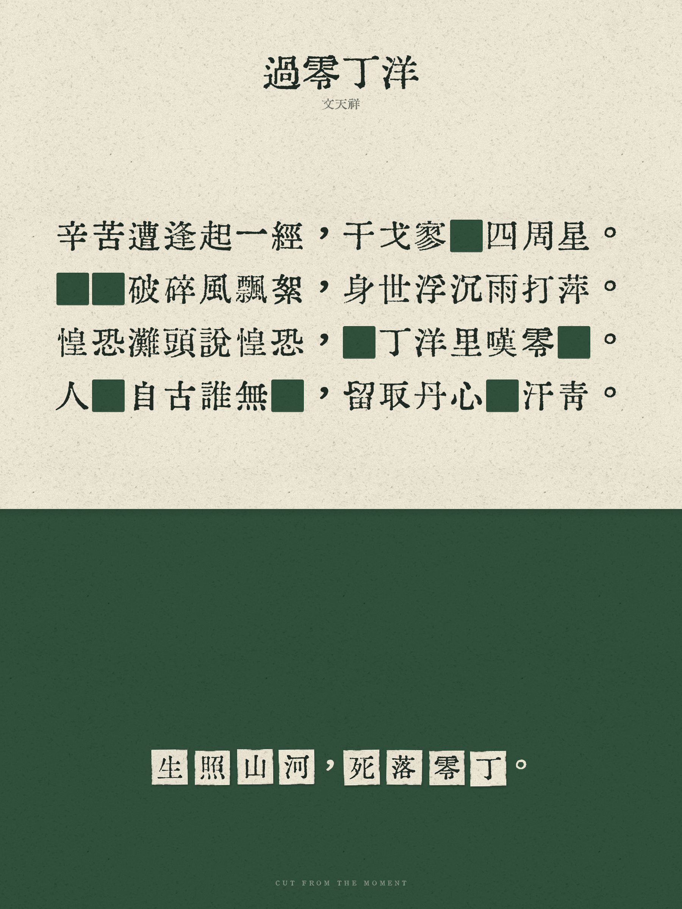

# 赛博诗词打孔器 · Cyber Poetry Punch

An installable AI agent skill that cuts selected Chinese characters out of a poem and rearranges them into a new phrase, rendered as a textured two-tone paper collage.

把古诗词中的字“挖出”，重排成一句新的话。内置汇文明朝体和真实米纸扫描纹理，导出高清 PNG；渲染不需要模型 API、密钥或联网。



## 给其他 AI 的入口

- **Skill 指令**：[SKILL.md](SKILL.md)
- **可直接读取的指令**：https://raw.githubusercontent.com/shilyed/cyber-poetry-punch/main/SKILL.md
- **输入字段**：[references/plan-schema.md](references/plan-schema.md)
- **可运行示例**：[examples/guo-ling-ding-yang.json](examples/guo-ling-ding-yang.json)

可以把这段话交给具备终端执行能力的 AI：

> 从 https://github.com/shilyed/cyber-poetry-punch 安装这个 skill。读取仓库根目录的 SKILL.md，保留 scripts、assets 和 references 的相对位置，安装 requirements.txt 中的依赖，再按 skill 指令生成诗词打孔图片。不要只下载 SKILL.md；字体和纸纹素材也是必需的。

这是文件型 **agent skill**，不是已托管的 HTTP API，也不是 MCP server。AI 必须能下载仓库、读取指令并运行 Python；只能聊天、不能执行代码的 AI 无法直接渲染。

命令行的标准输出和错误输出统一使用 UTF-8，便于 AI 通过子进程读取中文预览及错误消息。

## 安装到 AI 工具

仓库根目录就是一个完整 skill，具有标准的 `name` / `description` frontmatter。把整个仓库克隆到工具的 skill 目录即可；工具须支持本地 skills，并允许 Python 执行。

以下为 PowerShell 示例，任选一种：

```powershell
# Codex：个人 skill
git clone https://github.com/shilyed/cyber-poetry-punch.git (Join-Path $HOME '.codex\skills\cyber-poetry-punch')

# Claude Code：个人 skill
git clone https://github.com/shilyed/cyber-poetry-punch.git (Join-Path $HOME '.claude\skills\cyber-poetry-punch')

# GitHub Copilot：当前项目的 skill，在项目根目录执行
git clone https://github.com/shilyed/cyber-poetry-punch.git '.github\skills\cyber-poetry-punch'
```

安装后重新加载工具的 skill 列表，或启动新会话。可用类似“用赛博诗词打孔器处理《过零丁洋》，挖出‘生照山河，死落零丁’”的请求触发。不同工具的发现机制和调用语法以其本身为准。

## 不依赖 AI，直接运行

需要 **Python 3.10+** 和 Pillow。Windows、macOS、Linux 均可使用内置字体渲染。

```powershell
git clone https://github.com/shilyed/cyber-poetry-punch.git
Set-Location cyber-poetry-punch
python -m venv .venv
.\.venv\Scripts\python.exe -m pip install -r requirements.txt
.\.venv\Scripts\python.exe scripts\render_punch_poem.py examples\guo-ling-ding-yang.json --check
.\.venv\Scripts\python.exe scripts\render_punch_poem.py examples\guo-ling-ding-yang.json -o outputs\poem-punch.png
```

macOS / Linux 使用虚拟环境中的 Python 执行同一脚本即可。没有虚拟环境时也可以通过已安装 Pillow 的 Python 运行。

**繁体说明**：默认开启繁体模式，但自动简繁转换依赖 Windows API。在 macOS / Linux 上，请直接提供繁体原文与新句，或设置 `"traditional": false` 使用简体；脚本不会在非 Windows 系统自动转换。

## 能力与边界

- 从原诗自动匹配目标字，也支持显式指定行号和字位；缺字或数量不足会报错。
- 支持朱红、墨绿、藏青、黑、赭石及自定义配色。
- 默认 1800 × 2400，保留手撕纸片、轻微错位和接触投影。
- 真实扫描纸纹用于背景与字纸片，素材内置，同一输入和种子可复现。
- 不负责自动联网找诗；AI 应核对诗词原文，或使用用户提供的文本。
- 不包含远程服务、外部模型调用、账号凭据或遥测。

## 检查

```powershell
python -m unittest discover -s tests -v
```

GitHub Actions 在 Windows 和 Linux 上执行同一套针对性检查。

## 授权与素材署名

**脚本、skill 指令和仓库自有说明：MIT**，见 [LICENSE](LICENSE)。第三方素材不在 MIT 重新授权范围内：

| 内容 | 作者 / 来源 | 授权 |
|---|---|---|
| 汇文明朝体（符号修正版） | 特里王；[bosswnx/huiwenmincho-improved](https://github.com/bosswnx/huiwenmincho-improved) | CC0，见 [字体声明](assets/fonts/NOTICE.md) |
| Rice Paper 扫描纹理 | Atle Mo / [Subtle Patterns](https://www.toptal.com/designers/subtlepatterns/rice-paper/) | [CC BY-SA 3.0](https://creativecommons.org/licenses/by-sa/3.0/)，见 [纸纹声明](assets/textures/NOTICE.md) |

Rice Paper 是作者标注的米纸扫描。渲染会对其进行灰度化、缩放、平铺、取样、明度归一化及着色；改编的纸纹继续适用 CC BY-SA 3.0。

示例图片也使用上述纸纹。输出 PNG 内嵌来源、授权和修改说明；若发布平台会移除图片元数据，请在随图说明中保留：

> Paper texture: Rice Paper by Atle Mo / Subtle Patterns, https://www.toptal.com/designers/subtlepatterns/rice-paper/ — CC BY-SA 3.0, https://creativecommons.org/licenses/by-sa/3.0/. Adapted through grayscale conversion, resizing, tiling, sampling, luminance normalization and tinting.
